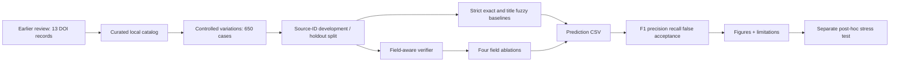

# AI Tools for Research — All 18 Prompt Responses

**Project:** A Controlled Pilot Study of Bibliographic Consistency Verification Under Citation Formatting Variation and Metadata Errors  
**Prior work:** *The Influence of Citation Formatting on Human Trust in Fabricated References*  
**Evidence convention:** VERIFIED = original uploaded source or local execution; INFERRED = proposed reasoning; UNKNOWN / [TEST REQUIRED] = not yet independently checked.  
**Scope note:** This is a controlled computational study, not a measured human-trust study and not a direct software reproduction of an original reviewed paper. The dataset consists of 13 reviewed bibliographic records with 650 deliberately constructed cases.  
**Measured local outputs:** 8 passing unit tests; 4,550 predictions; primary holdout F1 values 0.333, 0.667 and 1.000; separate post-hoc changed-title failure 5/13. See `results/` for traceable execution.  

---

# Prompt 01 — Set up an accountable research workspace

**Review scope [VERIFIED from upload].** The earlier paper is a narrative review of (i) visible citation cues and reader trust, (ii) inaccurate or nonexistent AI-generated references, and (iii) deliberate checking of references. It does not report newly collected participant responses. The review's pages 5–6 propose separate human-trust experiments but also a hierarchy of reference checks. The project begins from that hierarchy.

**Workspace [VERIFIED as created].** `configs/frozen_protocol.json` records the experiment; `research_decisions.md` contains decisions and their source status; `data/seed_references.csv` traces every DOI entry to its reference number; `src/study.py` and `tests/test_study.py` contain executable methods and tests; `results/` holds actual outputs; `paper/` contains IEEE LaTeX and a compiled PDF; `ai_assistance_log.md` captures the assistance audit. The standalone notebook is in `notebooks/`.

**Evidence labels.** VERIFIED = directly inspected in the attached review or obtained by a real local execution/primary source check; INFERRED = proposed interpretation or scientific rationale; UNKNOWN = lacking personal, registry or human-subject verification. Source metadata is only fully spot-checked for R04, R12 and R13; the other ten references remain `review_transcribed`.

**Research decision.** Use Pathway B (controlled computational comparison) rather than claim a new human-trust finding. **Next student action:** check the remaining DOI records and rerun Colab; no claim is made that the student's personal verification already occurred.

**Primary artifact links within this ZIP:** `README.md`, `research_decisions.md`, `configs/frozen_protocol.json`, `results/`, `paper/`, `notebooks/` and `docs/` as applicable.


---

# Prompt 02 — Extract evidence-based research gaps

The following gaps are **candidate computational or experimental questions**, not verified new discoveries. Links to the earlier review are section references; source publications must be independently checked before attributing their own author-reported limitations.

| Gap | Review evidence | Status | Testable question and evidence |
|---|---|---|---|
| G1: Format-robust verification | §§3.2–3.3, 5, 6.1 discuss completeness, identifiers, metadata checking | INFERRED computational need | Does normalization preserve matches under benign title/DOI formatting? Test exact vs normalized methods on paired records. |
| G2: Field-specific metadata errors | §4.2 describes both nonexistent and inaccurate citations; §5 separates existence, metadata and support | VERIFIED review discussion; experiments INFERRED | Which author/year/title/DOI corruptions are detected by which rules? Controlled field ablation. |
| G3: Visible DOI versus clicked source | §§3.3, 7 discuss DOI display, resolution and actual checking | INFERRED human-effect | Compare no identifier / plain DOI / live link in actual reader study with logged clicks; **not measured here**. |
| G4: Bibliographic completeness and trust | §§3.2, 7 state effect of full references on trust is unestablished | INFERRED, requires people | Hold claim/source status constant; randomize short/full citations and collect trust ratings. **Not measured here**. |
| G5: Verification prompt/cognitive forcing | §§6.3–6.4 discuss deliberate verification/lateral reading | INFERRED adaptation | Compare free browsing vs mandatory checking under approved participant study; time and correction rate. **Not measured here**. |

**Ranking for a CPU-only, short course project:** 1st G1 (strong feasibility, immediate coding); 2nd G2 (valuable failure taxonomy, straightforward ablation); 3rd G3 (research significance but ethics/participant and interactive link requirements increase cost). G4/G5 require supervised human experiments and cannot be replaced by synthetic user ratings. The selected experiment investigates G1+G2. **Novelty remains UNKNOWN**: no comprehensive systematic search of existing bibliographic matching systems was completed.

**Primary artifact links within this ZIP:** `README.md`, `research_decisions.md`, `configs/frozen_protocol.json`, `results/`, `paper/`, `notebooks/` and `docs/` as applicable.


---

# Prompt 03 — Map the literature to an executable experiment

Three **published empirical methods discussed in the review** can guide the experiment but are **not** claimed to be reusable software baselines:

| Published study | Method as described in review | Dataset / access | Metrics | Limitations / resources |
|---|---|---|---|---|
| Walters & Wilder 2023, DOI `10.1038/s41598-023-41032-5` | Human checking of 636 generated citations in 84 generated reviews | Publication verified; raw task-level extraction/code access UNKNOWN | Citation existence/errors | Human labor; model prompts and tasks differ from this pilot |
| Bhattacharyya et al. 2023, DOI `10.7759/cureus.39238` | Manual classification of authentic, inaccurate and fabricated references | Publisher/PubMed paper verified; raw labeled dataset/code access UNKNOWN | Category proportions / field errors | Biomedical domain and manual provenance |
| Putnam & Phelps 2017, DOI `10.1016/j.actpsy.2017.07.010` | Controlled presence/absence of in-text citation, human truth judgments | Published study verified; participant-level data/code access UNKNOWN | Belief/truth judgment effects | Measures humans, **not** bibliographic correctness |

**Bridge:** published audits show that checking citation metadata is important → an offline catalog models the initial identity-check stage → strict exact equality (B1) and fuzzy title matching (B2) are transparent **author-defined comparators** → DOI+title+author+year matching (M) is the studied combined check → measured predictions on controlled corruptions test RQ1 and RQ2. We do **not** describe B1/B2/M as reproductions of published algorithms.

**Pathway comparison.** A: reproduce a published citation audit (needs access to model outputs and human labels; high provenance burden); B: compare three deterministic rules (small working CPU baseline, matched data and metrics; selected); C: change a matching threshold or field (cheap but easy to overfit; executed only as field ablations, not novelty).

**Minimum viable experiment:** 13 reviewed citations, 650 deterministic cases, seven algorithms incl. four ablations, F1/FAR and failure stress check; fits ordinary CPU and one Colab notebook. **Independent checks:** verify ten unresolved references, check paper rights/licenses, confirm Colab environment and do not treat catalog-only lookup as online DOI verification.

**Primary artifact links within this ZIP:** `README.md`, `research_decisions.md`, `configs/frozen_protocol.json`, `results/`, `paper/`, `notebooks/` and `docs/` as applicable.


---

# Prompt 04 — Check feasibility, novelty and resource access

**Narrow, viable scope:** bibliographic **metadata consistency within a known offline catalog**. No new neural architecture, external model weights, account keys or GPU are needed.

**Scholarly search strings for a formal novelty check:** `"citation verification" "Crossref" title author DOI`; `"bibliographic reference matching" fuzzy title DOI precision recall`; `"hallucinated references" metadata consistency benchmark`; `"DOI validation" bibliographic metadata errors`; `"citation matching" character similarity error detection`. Search Crossref, ACM Digital Library, Semantic Scholar, Google Scholar, Scopus/Dimensions (as institutionally available), and backward citations of the original review. Inspect metadata matching, record linkage, approximate string matching and hallucination verification. **A complete search was not performed here.**

| Published work | Verified published contribution | Difference in this pilot | Missing evidence |
|---|---|---|---|
| Putnam & Phelps (2017) | Source/publisher-confirmed citation presence and belief study | Computational metadata consistency, not belief | Human study datasets/code UNKNOWN |
| Walters & Wilder (2023) | Publisher-confirmed AI citation bibliography audit | Deterministic perturbation and rule ablation | Full original labeled audit data UNKNOWN |
| Bhattacharyya et al. (2023) | Publisher-confirmed inaccurate vs nonexistent record classification | Local DOI/title/author/year comparison | Direct published algorithm for this exact benchmark UNKNOWN |

**Access ledger:** seed CSV [VERIFIED local file]; frozen code [VERIFIED locally executed]; three original DOI/publication records [SPOTCHECKED]; ten original bibliographic records [review-derived, REGISTRY CHECK PENDING]; external API [Crossref documentation verified, network use not tested]; external model weights [NOT USED]. Dataset includes only bibliographic descriptions, not copyrighted full texts. Official content/redistribution terms should be checked for any extension.

**Compute estimate (not promised runtime):** ordinary laptop or Colab CPU; memory modest for 13 references and 650 cases. Observed local experiment processed 4,550 method predictions; measured versions/timing in `results/run_manifest.json`. Hardware/time available from the student are UNKNOWN. **Go decision:** yes for a bounded course-level pilot; **no-go** for human-trust claims or worldwide metadata verification. **Fallback:** if original publisher data cannot be verified, report review-transcribed provenance instead of making claims of complete validation.

**Primary artifact links within this ZIP:** `README.md`, `research_decisions.md`, `configs/frozen_protocol.json`, `results/`, `paper/`, `notebooks/` and `docs/` as applicable.


---

# Prompt 05 — Frame research questions and success criteria

**Research problem.** The prior review separates scholarly appearance from true bibliographic identity. This implementation asks whether a small field-aware bibliographic consistency check behaves more reliably under predefined formatting and metadata errors than two simple controls.

| RQ | Input / comparator | Independent variable | Dependent metric | Prespecified decision / contradiction |
|---|---|---|---|---|
| RQ1: Does cross-field checking improve consistency detection? | 13-source catalog; 650 controlled cases; strict vs title vs field-aware | Verification rule | Holdout F1 (primary), FAR and recall (secondary) | Descriptive improvement in F1 without worse FAR supports the expected pattern; no improvement contradicts it |
| RQ2: Which metadata fields matter on these errors? | Field-aware and four field-removal ablations | Which check is omitted | Holdout F1 and FAR | Higher FAR with a field omitted indicates reliance on that field under this generator; unchanged metrics contradict that mechanism |
| RQ3: Does a subtle unplanned title alteration bypass checks? | Added 13 altered-title cases | Post-hoc title prefix | Fraction incorrectly accepted | Any false acceptance contradicts perfect robustness to changed titles; not included in primary metric |

**Source-level partition:** 8 development/5 holdout source IDs, split seed 20261117; all five corruptions and five harmless variations applied consistently. **Fixed settings:** 0.86 title-only and 0.89 field-aware similarity thresholds, perturbation seeds `[11,23,47,59,83]`. Higher F1, precision, recall and balanced accuracy are favorable; **lower** false acceptance and rejection are favorable.

**Contribution claimed:** a reproducible pilot comparison and an error-aware analysis, **not** an invented algorithm, verified research novelty, real-world citation detection performance, human trust or a causal experiment on people. **Result after execution:** primary F1 0.333 / 0.667 / 1.000; exploratory stress identifies 5/13 false accepts. Separate `docs/one_page_research_brief.md` is the one-page G1 handout.

**Primary artifact links within this ZIP:** `README.md`, `research_decisions.md`, `configs/frozen_protocol.json`, `results/`, `paper/`, `notebooks/` and `docs/` as applicable.


---

# Prompt 06 — Verify datasets and comparators

**Dataset choice.** Use thirteen DOI-bearing entries from the references of the attached narrative review (see `data/seed_references.csv`). Each contains ref ID, first author, title, year, DOI, origin and source-verification status. The original review's PDF is the extraction source, **not** a fully verified registry export. Independent spot-checks: R04 / R12 / R13. The rest must be independently checked against DOI registry/publisher records.

**Baselines.** B1 strict equality across four fields; B2 fuzzy normalized title similarity only. Neither is called a reproduction of a peer-reviewed software algorithm. M is a DOI-first cross-field consistency comparator, not a deployed discovery system. No model weights or training data are needed.

**Protocol and legality:** metadata records only, no article full texts or participant data. Individual publisher record URLs were inspected for three references; the official Crossref REST API documentation confirms that a public metadata service exists, but API calls were **not** used in the measured code. License/access for systematic bulk harvesting remains [TO VERIFY] if the study is expanded. `requirements.txt` documents package compatibility ranges.

**Splits:** maintain one frozen catalog of 13 records; separate generated *query examples* by parent source into 8 development and 5 holdout records; do **not** split synthetic siblings of one reference across train/test. There is no trained model, and the complete lookup catalog intentionally contains holdout sources. This is appropriate for closed-catalog matching but does **not** establish open-world generalization.

**Leakage audit:** unique source IDs, source-disjoint example partitions, same perturbation types across methods, unchanged catalog and fixed thresholds; code asserts these properties. **Pitfalls:** noisy or inaccurate original metadata, a publisher title change, missing DOI, same author surname across papers, constructed errors that are easier than actual fabricated LLM references, and confusing metadata agreement with evidence support. See `docs/baseline_validation.md`.

**Primary artifact links within this ZIP:** `README.md`, `research_decisions.md`, `configs/frozen_protocol.json`, `results/`, `paper/`, `notebooks/` and `docs/` as applicable.


---

# Prompt 07 — Freeze an experiment blueprint before viewing results

**Frozen primary specification:** `configs/frozen_protocol.json` was created before the first project run. Input is a 4-field citation record `(title, first_author, year, doi)`; output is binary consistency (1 = all displayed fields agree with one reviewed catalog record, 0 = generated disagreement). All methods get the same 650 cases. Repeat with five fixed perturbation seeds and a fixed 8/5 source-ID split.



**Preprocessing:** lowercase and strip punctuation/spacing from title for fuzzy methods; remove DOI URL prefix/`doi:` and trailing punctuation for metadata-aware; match first-author normalized surname and exact year. **Thresholds:** title-only 0.86; field-aware title 0.89. No learning or test-time optimization occurs.

**Primary metric:** holdout F1 [higher]. **Secondary:** precision, recall, balanced accuracy [higher]; false acceptance/rejection [lower]. `results.csv` is a mean/SD summary over five generator seeds. Per-source independence is limited, so no inferential significance test is planned. Ablations are prespecified; stress-check variation was added **after** primary results and is disclosed as exploratory.

**Before running checklist:** fixed source list and provenance; frozen split and seeds; label definitions; method code; thresholds; all methods use identical cases; no DOI external validation claim; no participant data. **Change protocol:** log why, when, and whether an analysis is exploratory before making new claims. See `research_decisions.md`, particularly the post-hoc entry.

**Primary artifact links within this ZIP:** `README.md`, `research_decisions.md`, `configs/frozen_protocol.json`, `results/`, `paper/`, `notebooks/` and `docs/` as applicable.


---

# Prompt 08 — Configure and test the coding environment

**Target environment:** Google Colab CPU (GPU is unnecessary), or ordinary Python environment. Core libraries: Python standard library, NumPy, pandas, Matplotlib, scikit-learn. `requirements.txt` uses tested broad version ranges; `run_manifest.json` records actual versions from the local execution rather than claiming all future Colab versions are compatible.

**Local commands:**

```bash
python -m pip install -r requirements.txt   # TEST REQUIRED on student's machine
python -m unittest discover -s tests -v
python scripts/run_experiment.py
python scripts/run_stress_test.py
```

**Actual environment check [VERIFIED locally]:** all eight unit tests passed. The study executed with 13 source references, produced 650 cases and 4,550 predictions, exported figures/CSVs. The exact package/platform details are in `results/run_manifest.json`; the genuine console output is in `results/experiment_console_log.txt` and `results/unit_test_console_log.txt`.

**Colab procedure:** upload `notebooks/Citation_Metadata_Verification_Colab.ipynb`; Runtime→Run all; observe printed package versions; compare summary CSV and figures; optionally download the zipped outputs. This notebook includes embedded source records and code; no proprietary data, keys or third-party API are needed. A student's **remote Colab run is [TEST REQUIRED]**, although the notebook was prepared for self-contained execution.

**Expected output type:** text diagnostics, numeric pandas result table, PNG/PDF plots, CSV files and a zip of Colab outputs. **If a run fails:** first check package import errors / Python version, then relative file paths, root directory, source CSV presence, import of `src.study`, and deterministic `sample_id` uniqueness. Do not invent console logs. The primary execution log is attached rather than stopping at an unrun environment sketch.

**Primary artifact links within this ZIP:** `README.md`, `research_decisions.md`, `configs/frozen_protocol.json`, `results/`, `paper/`, `notebooks/` and `docs/` as applicable.


---

# Prompt 09 — Vibe-code one baseline module at a time

**Module 1 — Load and validate.** `load_records(path)` reads 13 bibliography rows and asserts mandatory columns, unique record IDs/DOIs and no missing fields. **Input shape:** `(13, 7)` source CSV. **Output:** list of dictionaries representing the catalog. Sanity test: all distinct DOIs and years in the allowed range.

**Module 2 — Create controlled cases.** `build_dataset(records)` applies ten fixed variants per source per seed. **Output shape:** `(650, …)` DataFrame with `sample_id`, `source_id`, `generator_seed`, `variation`, field values, ground-truth consistency and source partition. Sanity tests: 650 unique samples, 50% positives, no overlap of holdout source IDs.

**Module 3 — Comparator logic.** `predict(sample,catalog,'strict_exact')` checks literal field equality. The fuzzy comparator retrieves the nearest normalized title using `SequenceMatcher` and threshold 0.86. The field-aware method normalizes DOI and then requires title similarity at least 0.89, first-author equality and year agreement. Input = one dictionary and the frozen catalog; output = integer 0/1. Tests cover DOI URL conversion, a wrong DOI, a wrong year and baseline brittleness.

**Module 4 — Evaluation and saving.** `run_project(ROOT)` applies seven methods to 650 test cases, writes `predictions.csv` (4,550 rows), computes metrics for development and holdout by seed, outputs `results.csv` and saved PNG/PDF figures. No neural training is required.

**Module 5 — Independent stress-check.** `run_stress_test.py` adds a previously untested title prefix to all thirteen titles and records false acceptance separately. This was added after primary evaluation, so it is labeled **post-hoc**.

**Actual programming evidence:** `tests/test_study.py` passed 8/8 tests; scripts were locally executed, not pseudocode. `src/study.py` contains the complete source and comments. **Important deviation:** no official code for a published citation-verification algorithm was reproduced; this is the documented Pathway B computational comparison.

**Primary artifact links within this ZIP:** `README.md`, `research_decisions.md`, `configs/frozen_protocol.json`, `results/`, `paper/`, `notebooks/` and `docs/` as applicable.


---

# Prompt 10 — Verify and reproduce the baseline

**Baseline validation report:** `docs/baseline_validation.md`. The requested published-method reproduction does not apply directly because the original review's core studies are human judgments or bibliographic audits, not a published executable field-matching algorithm. This project openly uses author-defined comparators instead.

**VERIFIED local behavior:** all 8 unit tests pass; B1 rejects a DOI wrapped in `https://doi.org/` because it is no longer string-exact; B2 accepts a title paired with a wrong DOI because it deliberately checks title alone; M rejects wrong DOI and year examples and accepts normalized DOI URLs. All methods receive identical holdout cases. Fixed seeds and source-identity split are documented in the manifest.

**Measured primary holdout:** B1 F1 = 0.333, precision = 1.000, recall = 0.200; B2 F1 = 0.667, precision = 0.500, recall = 1.000; M F1 = 1.000, precision = 1.000, recall = 1.000. These are **internal synthetic benchmark values**, not published-study reproduction values.

**UNCERTAIN:** catalog accuracy outside three spot-checked publications; effectiveness on real LLM-generated references; behavior with missing/unregistered DOI; metadata aliases. **NEEDS CORRECTION for stronger claims:** add independent source verification, open-world retrieval and a natural error corpus before describing the software as a validated production verifier.

**Acceptable adaptation:** deterministic authored baselines under Pathway B. **Unacceptable claim:** saying Walters, Bhattacharyya or Putnam already reported these F1 numbers, or that this implementation exactly reproduced their experiments. `results/` provides actual logs and confusion figures.

**Primary artifact links within this ZIP:** `README.md`, `research_decisions.md`, `configs/frozen_protocol.json`, `results/`, `paper/`, `notebooks/` and `docs/` as applicable.


---

# Prompt 11 — Debug using actual evidence

**Actual error evidence:** no unexpected Python traceback occurred in the recorded local unit test or main experiment. It would be dishonest to invent a failure-and-fix history. `results/unit_test_console_log.txt` shows eight passing tests, and the run log shows successfully written outputs.

**Purposeful verification case [VERIFIED]:** a reference with a correct DOI displayed as `https://doi.org/<DOI>` is bibliographically consistent but fails literal matching in B1. **Observed test assertion:** strict baseline predicts 0; field-aware DOI normalization predicts 1. This is an intentionally designed comparator limitation, **not a debugging failure**.

**Real limitation exposed after execution [VERIFIED exploratory]:** for thirteen references, prepend `A systematic review of` to the stored title, leaving DOI/author/year unchanged. These are inconsistent titles. Expected perfect verifier behavior would be to reject all. Actual outputs: strict exact rejects 13/13, title-only falsely accepts 10/13 and field-aware falsely accepts 5/13. Likely cause: high character-sequence similarity, particularly for long titles. We did **not** revise the frozen primary algorithm after this finding.

**Minimal safe future correction [NOT IMPLEMENTED]:** introduce an explicit phrase-level title agreement check or registry-supported title tokens; tune on a separate development set and repeat evaluation on a new held-out set. Regression tests should include the five observed false accepts. **Edge case:** a genuinely retitled paper or alternate-translated title might be falsely rejected; abstain or request manual review rather than declare fabrication. Document any such change as a new experiment, not a fix that retrospectively improves primary metrics.

**Primary artifact links within this ZIP:** `README.md`, `research_decisions.md`, `configs/frozen_protocol.json`, `results/`, `paper/`, `notebooks/` and `docs/` as applicable.


---

# Prompt 12 — Choose and evaluate a defensible contribution

**Actual validated local baseline:** eight unit tests pass; B1/B2 comparison outputs are saved. Their F1 values are 0.333 and 0.667, respectively, on the project's frozen synthetic holdout. The question is field-aware detection of inconsistent citation metadata, not reader trust.

| Pathway | Question | Code burden | Pros / failure risks | Evidence |
|---|---|---|---|---|
| A Reproduction + extension | Can a published AI bibliography audit be replicated under one new condition? | High: audited source records or model outputs needed | Direct tie to original studies, but raw datasets/source verification unknown | Original protocol, sample output and labels |
| B Controlled comparison **SELECTED** | Which checks balance benign formatting tolerance and inconsistent-field rejection? | Low CPU; exact/fuzzy/multi-field rules | Fair controls and ablation possible; risks easy synthetic generator | 650 identical cases for every method, F1/FAR, per-variation analysis |
| C Targeted modification | Does a title threshold or additional field help after the base method is fixed? | Low code but calibration needed | Tests mechanism; risks selecting threshold after test | Independent development calibration + unseen holdout |

**Decision:** Pathway B is defensible for the short time and self-contained resources, because it produces genuine outputs without fabricating participants or expensive model training. We deliberately compare three rules and four field ablations. Method M requires DOI lookup in the local catalog, normalized title similarity at least 0.89, matching first author and matching year. B1 and B2 preserve their original definitions in all comparisons.

**Research claim boundary:** The observed F1=1.000 for M is credible *only within this synthetic generator*. A separately labeled exploratory stress check produced 5/13 false accepts, demonstrating the limitation. No guarantee of improvement against actual published software or natural errors is made.

**Primary artifact links within this ZIP:** `README.md`, `research_decisions.md`, `configs/frozen_protocol.json`, `results/`, `paper/`, `notebooks/` and `docs/` as applicable.


---

# Prompt 13 — Evaluate using real outputs only

**Measured files [VERIFIED actual local execution].** `results/synthetic_test_cases.csv` has 650 uniquely identified cases. `results/predictions.csv` contains 4,550 predictions, one per case × method. `results/metrics_by_seed.csv` and `results/results.csv` are computed directly from these predictions, and plots are generated by the same script. `run_manifest.json` records source partitions, seed choices and package versions.

**Alignment checks:** script confirms unique sample ID, label balance, required fields, non-null bibliographic metadata and source-disjoint development/holdout samples. All methods use the same immutable catalog; no method uses a different case split. No training or test-set tuning occurs. All reported results below refer to the **5-source / 250-case holdout**, averaged over five deterministic seeds.

| Method | F1 ↑ | Precision ↑ | Recall ↑ | False acceptance ↓ |
|---|---:|---:|---:|---:|
| B1 Strict exact | 0.333 | 1.000 | 0.200 | 0.000 |
| B2 Fuzzy title | 0.667 | 0.500 | 1.000 | 1.000 |
| M Metadata-aware | 1.000 | 1.000 | 1.000 | 0.000 |

**Ablations:** remove DOI → F1 0.833 / FAR 0.400; remove author → 0.909 / 0.200; remove year → 0.909 / 0.200; remove title → 0.909 / 0.200. **Exploratory title-prefix stress (not primary):** M accepts 5/13 wrong titles.

**Output figures:** `results/figures/methods_comparison.png/.pdf`, `variation_robustness.png/.pdf`, `ablation_f1.png/.pdf`. Mean/SD across synthetic seeds is **descriptive** only; zero within-seed variation must not be interpreted as narrow statistical uncertainty. No p-value or causal claim is asserted.

**Primary artifact links within this ZIP:** `README.md`, `research_decisions.md`, `configs/frozen_protocol.json`, `results/`, `paper/`, `notebooks/` and `docs/` as applicable.


---

# Prompt 14 — Interpret outcomes, including negative results

**RQ1 direct observation:** field-aware F1=1.000 exceeds B1=0.333 and B2=0.667 on **the defined 650-case synthetic study**. The likely mechanism is combining DOI normalization with title/author/year agreement: B1 rejects innocuous presentation changes; B2 ignores mismatches outside the title. **Alternative explanation:** the benchmark is constructed to be easy for the exact fields M checks; the lookup catalog already contains every genuine holdout title.

**RQ2 direct observation:** removing DOI drops F1 to 0.833, removing each other field to 0.909. These are designed-error dependencies, not evidence that DOI mismatches are more common in real AI output. Five perturbation seeds do not offer five independent corpora; the same 13 sources are repeated.

**RQ3 negative result:** a separate post-hoc stress check added an incorrect title prefix. M incorrectly accepted **5 of 13** cases, despite perfect primary performance. **Likely explanation [INFERRED]:** long titles can maintain character similarity above 0.89 after a misleading prefix. This reveals that low-level text similarity cannot guarantee bibliographic identity. B2 falsely accepted 10/13.

**Resource note:** scripts ran on an ordinary CPU locally; the runtime and package versions are in the manifest. No GPU or API requests were measured. No reliable between-machine latency claim is made.

**Threats:** 13 reviewed sources; only three independently spot-checked; synthetic rather than naturally generated errors; small closed catalog; incomplete DOI coverage; no source relevance checks; no human responses; title threshold heuristic; no external algorithmic competitor. Therefore the hypotheses are *supported by the synthetic primary cases* but unresolved for deployment.

**Three highest-value follow-ups:** (1) cheaply verify the remaining ten metadata records from primary registry/publisher records; (2) moderately expand to a disjoint public corpus with real reference mistakes and held-out error categories; (3) more costly, preregister a human-reader study measuring trust and verification separately. Do not relabel the post-hoc stress test as prespecified.

**Primary artifact links within this ZIP:** `README.md`, `research_decisions.md`, `configs/frozen_protocol.json`, `results/`, `paper/`, `notebooks/` and `docs/` as applicable.


---

# Prompt 15 — Draft an evidence-grounded manuscript in LaTeX

**Deliverable [VERIFIED artifact]:** `paper/main.tex` (IEEE conference format), `paper/references.bib`, `paper/figures/*.pdf`, and compiled `paper/main.pdf`. The document contains actual primary result tables and the separately identified exploratory failure results. The locally compiled PDF should be checked for page count and visual quality before handing in.

**Section outline:** (1) Abstract drafted after data; (2) Introduction / previous narrative review; (3) Background / distinction between human belief and citation accuracy; (4) Materials / source provenance and synthetic cases; (5) Methods / three comparators and four field ablations; (6) Evaluation and measured results; (7) Discussion of alternative explanations; (8) Threats and limitations; (9) Conclusion and future work; (10) Code and reproducibility appendix; (11) references.

**Evidence checklist:** all numeric results linked to `results/results.csv` and `results/exploratory_stress_test.csv`; 13 DOI records listed in `data/seed_references.csv`; three spot-checked bibliography entries linked to publisher/PubMed sites; other entries explicitly marked review-transcribed; exact method thresholds reflected in frozen JSON and source; all figures generated from actual predictions; human-trust measurements absent rather than invented.

**Overleaf upload:** create new blank project, upload all files within `paper/` retaining `figures/`; main file `main.tex`; compiler pdfLaTeX; bibliography BibTeX. An ordinary fresh Overleaf project can compile with an IEEEtran class. **Actual BibTeX metadata entries included** for Putnam & Phelps (2017), Walters & Wilder (2023), Bhattacharyya et al. (2023) and the Crossref REST documentation. Do not claim the experiment reproduced a published algorithm.

**Claims not allowed:** 'human trust increased', 'all citations validated against Crossref', 'the algorithm catches every hallucinated citation', 'publication-ready novelty demonstrated', or statistics beyond the generated outputs.

**Primary artifact links within this ZIP:** `README.md`, `research_decisions.md`, `configs/frozen_protocol.json`, `results/`, `paper/`, `notebooks/` and `docs/` as applicable.


---

# Prompt 16 — Conduct a demanding technical peer review

**Review type:** internal AI-assisted review of `paper/main.tex` and experiment files, **not** feedback from an independent reviewer. Complete report: `docs/technical_peer_review.md`.

**MAJOR 1 — Results validity (Methods/Results).** Thirteen catalog sources and straightforward controlled errors make a perfect F1 unsurprising. Remedy: present strictly as pilot and gather a larger independently audited error corpus.

**MAJOR 2 — Evidence provenance (Materials).** Ten transcribed references have not been independently checked. Remedy: verify DOI, title, year and author directly from original publisher or registry metadata and update the source ledger.

**MAJOR 3 — Construct validity (Introduction/Discussion).** Metadata matching is not human trust and cannot prove whether a reference supports a claim. Remedy: keep these separate in abstract and conclusion; no fabricated participant outcomes.

**MAJOR 4 — Generalization (Methods).** Holdout tests variations of known inventory items, not open-world source retrieval. Remedy: state this explicitly and evaluate unknown DOI and missing-data handling on an external catalog.

**MAJOR 5 — Known failure (Exploratory Results).** Prefix stress test gives M false acceptance 5/13; this compromises universal accuracy claims. Remedy: preserve it as post-hoc and run a newly prespecified external test before changing thresholds.

**MINOR:** explain FAR metric direction; note zero standard deviation across deterministic seeds; include package versions; title/punctuation normalization details; ensure figures are regenerated from CSV; disclose AI assistance.

**Author-response audit:** scope/limitations, failed stress results and figure links are incorporated in the manuscript; ten DOI validations, actual Colab account run and GitHub publication are **still pending student action**. Overall assessment: a documented course-level comparative pilot, not independently validated or publication-level evidence.

**Primary artifact links within this ZIP:** `README.md`, `research_decisions.md`, `configs/frozen_protocol.json`, `results/`, `paper/`, `notebooks/` and `docs/` as applicable.


---

# Prompt 17 — Prepare reproducible GitHub documentation

**Public-ready repo structure created:** root `README.md`, `QUICK_START.md`, `requirements.txt`, `configs/frozen_protocol.json`, `data/README.md`, `src/study.py`, `scripts/run_experiment.py`, `scripts/run_stress_test.py`, `tests/test_study.py`, `results/`, `paper/`, `notebooks/`, `prompts/`, `research_decisions.md`, `ai_assistance_log.md`, `LICENSE` and technical docs.

**Actual locally executed commands:**

```bash
python -m unittest discover -s tests -v
python scripts/run_experiment.py
python scripts/run_stress_test.py
```

**[TEST REQUIRED] on the student's own machine:** `python -m pip install -r requirements.txt`. **[TEST REQUIRED] cloud:** upload `notebooks/Citation_Metadata_Verification_Colab.ipynb` to Google Colab and Run all. A genuine local notebook execution check, if done, is separately recorded in `docs/notebook_run_report.md`.

**Input/data handling:** all 13 source records are already bundled; no network call or external dataset file is required; no credentials or model weights are needed. Reproduction outputs are CSV/PNG/PDF in `results/`, with 5 perturbation seeds and exact source splits in manifest. Student owns final source-identity verification and results explanation.

**Minimum second-student checklist:** clone/extract ZIP; inspect source CSV and DOI provenance; create Python environment; install requirements; run 8 unit tests; run main script and verify 650 cases, 4,550 predictions and three holdout F1 figures; run separate post-hoc stress; inspect manuscript/figure correspondence. The student must create a GitHub repository manually (or through their own authorized connector). **No repo URL, push, commit hash or public publication is claimed.** Source code MIT-licensed; original papers/metadata retain their terms.

**Primary artifact links within this ZIP:** `README.md`, `research_decisions.md`, `configs/frozen_protocol.json`, `results/`, `paper/`, `notebooks/` and `docs/` as applicable.


---

# Prompt 18 — Audit the human-AI collaboration

**Real provenance:** the student supplied an 11-page course instruction sheet and a 7-page prior narrative review and requested a runnable, complete implementation package. ChatGPT/GPT-6 proposed the narrower computational research question, wrote `src/study.py`, unit tests, the frozen comparison config, documentation, prompt answers and LaTeX paper. The code was actually executed in this workspace; `results/` holds the genuine console logs, numeric outputs and figures.

| AI-supported activity | Proposal | Real verification evidence | Human decision record |
|---|---|---|---|
| Literature-to-code bridge | Test citation metadata rather than fabricate reader trust | Review §§3,5–7 and dataset ledger | User approval of the precise narrower question not supplied |
| Coding and validation | Three methods, four ablations, controlled cases | Eight passing unit tests, 650 cases, 4,550 predictions | Student rerun/explanation still pending |
| Analysis | Compare held-out F1 and FAR | `results/results.csv` and generated PNG/PDF | Student interpretation not supplied |
| Critical checking | Probe changed-title titles | Post-hoc CSV shows 5/13 M false accepts | Added by assistant after first results; **explicitly exploratory** |
| Manuscript | IEEE-style research paper grounded in CSVs | Compiled PDF and BibTeX; figures match scripts | Student final scientific approval pending |

**Three genuine examples of AI limitations/checks:** (1) bibliographic provenance is incomplete for ten reviewed references, marked pending rather than invented; (2) no human-trust data exist, so the project studies a different measurable construct and explicitly states that limit; (3) the perfect initial metric masked a clear post-hoc failure of fuzzy title identity (5/13 accepted wrong prefixes). These are real validation limitations, not simulated student debugging stories.

**Unverified or absent events:** user-collected experiment logs, GitHub commits, participant studies, human judgement ratings, external code-review approval, user editing/decision history, and cloud account runs. Do not invent them. **Human-owned next steps:** source verification, independent Colab rerun, inspecting/accepting methodological assumptions, putting project in personal GitHub, and explaining the difference between citation appearance, metadata consistency and scientific claim support.

**Primary artifact links within this ZIP:** `README.md`, `research_decisions.md`, `configs/frozen_protocol.json`, `results/`, `paper/`, `notebooks/` and `docs/` as applicable.


---
